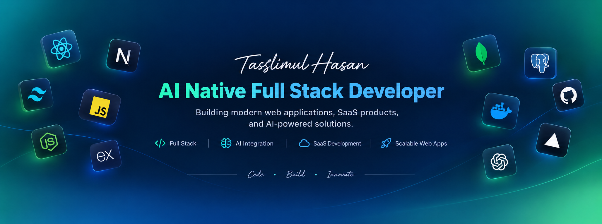

  

<h2 align="center">
  
</h2>

- 👋 Hi, I'm **@taslimul6**
- 🖥️ I'm currently working on **React.js, Next.js, TypeScript and Redux** for frontend development.
- 🗄️ Using **Node.js, Express.js, MongoDB, MySQL, PostgreSQL and Prisma** for the backend.
- 🌱 I'm currently learning **DevOps**.
- 💬 Ask me about **JavaScript, Next.js, Node.js**.
- 🌐 Explore my [Portfolio](https://taslimul.com) and my [Resume](https://taslimul.com/resume).
- 📝 I regularly write articles on my [Blog](https://taslimul.com/blog).
- 📫 Feel free to reach me at [hasantaslimul@gmail.com](mailto:hasantaslimul@gmail.com).

  

<h3 align="left">FOLLOW ME ON SOCIALS:</h3>

 <h3>TECHNOLOGY STACK:</h3>

### Languages:

### CSS Frameworks & Libraries:

### JavaScript Frameworks & Libraries:

### Database & Model:

### Deployment Platform:

### Design & Graphics:

### Tools & Technologies:

<h3 align="center">GITHUB STATISTICS & ANALYSIS:</h3>

**Repository Stats & Streak:**

<h3 align="center">RANDOM DEV QUOTE:</h3>

